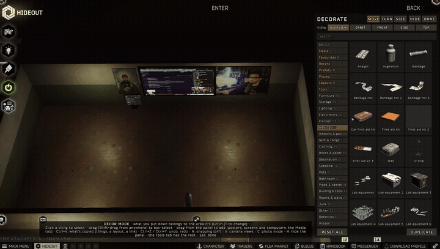

# Changelog

## 1.0.0

Requires SPT 4.1.x. Client-side only (the Fika co-op support is included). You can install it over 0.2.0: everything you've moved, hidden or placed is kept.

| | |
| --- | --- |
|  |  |
| **The computer** is a working web browser. | **Posters** sit flat on walls and size themselves to their picture. |
|  |  |
| **New posters** start blank: place them, then choose a picture. | **New panel tabs**: Favourites, Recent, Prefabs, Placed, Layouts and Tools. |

### Posters, TV screens and computers

- **Posters with your own pictures.** Drag a **Poster** in from the new **Media** tab. When it's selected, a bar appears at the top of the screen: paste a link to a picture (Ctrl+V, then Enter), or choose one of your own files from **LIBRARY**. Your files go in `BepInEx/plugins/HideoutInteriors/media`, and each one also appears in the Media tab so you can drag it straight in. Pictures can be .png or .jpg. Pictures from links are saved in `BepInEx/cache`, so they still show without an internet connection.
- **TV screens that play video** (.mp4 or .webm, from a link or the media folder). Videos loop, and the sound comes from the screen. Screens can show pictures too, and they glow rather than being lit by the room.
- **YouTube, Twitch and live streams.** A screen can play a YouTube video or live stream, a Twitch channel, a .m3u8 stream or any web page, with the video filling the screen. Type a few words into a screen's address box to search YouTube, then click the video you want. Cookie pop-ups are declined and skippable YouTube adverts are skipped automatically. **WHOLE PAGE** shows the full web page around the video, for signing in or choosing another video.
- **A computer for browsing the web.** Use the mouse and keyboard as normal: click, scroll, type, Ctrl+C and Ctrl+V. Its bar has back, forward, reload and home buttons, an address bar that also searches (Ctrl+L), and **SAVE** to bookmark the page. It reopens on the last page you visited. Pages are drawn by Microsoft Edge's WebView2 (built into Windows 10 and 11) in a small helper program, `browser/HideoutBrowser.exe`, which runs alongside the game and closes with it. Logins are kept in `BepInEx/cache/HideoutInteriors/browser`.
- **Use them without decor mode.** On the hideout overview, click a screen or computer to start using it, and the camera moves in front of it. When walking around the hideout, look at one and press **F** (you can change this key in the settings). The camera moves in front of it in the same way, your character stands still and the mouse is freed. Clicking or looking at a poster opens its bar, ready for a link. Press Esc, click **DONE** or click away from it to go back.
- **A control bar for each one.** Select a poster, screen or computer and its bar appears along the top. It has the address box, **PASTE**, **LIBRARY**, **SMALLER** and **BIGGER**. Screens also have **PAUSE**, skip back and forward 10 seconds, **MUTE**, their own volume, **PREV** and **NEXT** to flick through your channels, and **SAVE** to keep what's playing as a channel.
- **Slideshows and playlists.** **ADD TO LIST** adds what's showing to a playlist, **ALL FILES** adds everything in the media folder, and **EVERY** sets how long each picture stays up. Videos play to the end before moving on.
- **Frames.** **FRAME** on the bar cycles through the original frame, no frame, black, white, wood, dark wood, gold and silver.
- **Wall mounting.** Posters and screens sit flat against a wall when you carry them over one (press R to rotate them on the wall), and stand upright on floors and tables. Carry a screen over one of the hideout's TVs, monitors or laptops and it fits itself to the display. Alternatively, select the TV and press **Ctrl+V** with a video link copied.
- **P** pauses the selected screens and **M** mutes them. Videos go quiet while you're in the game's other menus. **Video volume** in the settings controls the overall volume.

### Editing

- **Undo and redo.** **Ctrl+Z** undoes and **Ctrl+Y** (or Ctrl+Shift+Z) redoes, up to 60 steps. This covers moving, rotating, resizing, copying, removing and hiding things, changing what's on a poster, light colours, loading a layout and even **RESET ALL**.
- **Resize anything**, including the hideout's own objects. **+** and **-** resize the selection (hold Shift for smaller steps). The gizmo has a third mode, **SIZE**, for stretching an object along one axis (drag the centre block to resize the whole thing). On a poster or screen, the handles set its width and height. **Backspace** returns one of the hideout's own objects to its original size and position.
- **Duplicate.** **Ctrl+D** copies the selection, including the hideout's own objects. The copies follow the mouse until you click to place them.
- **Snapping.** **N** cycles between off, a grid (25 cm by default; change it on the Tools tab or in the settings), snapping to the edges of nearby objects, and both. Hold **Alt** to place without snapping. **B** drops the selection onto whatever is beneath it.
- **Alignment.** The **Tools** tab can line up the selection along X, Y or Z (by edges or centres), space it out evenly, or arrange it in a row.
- **Mirror.** **X** and **Z** mirror the selection across that axis, so you can copy one half of a room onto the other. Press it again to undo the mirror. Posters and screens are turned around rather than mirrored, so their pictures aren't back to front.
- **Groups.** **Ctrl+G** groups the selection under a name, so clicking one object selects the whole group (Alt+click selects just one). **Ctrl+Shift+G** ungroups.
- **Locking.** **L** locks the selection so it can't be clicked, box-selected or picked by Ctrl+A. **Shift+L** unlocks everything.
- **Renaming.** **F2** gives the selection a custom name.
- **Selecting.** Shift+drag anywhere to draw a selection box, even when starting on top of an object. **Ctrl+A** selects everything visible on screen.

### Interactive objects

- **Adjustable lights.** Select anything with a lamp in it to get a light bar: switch it on or off (**O**), dim or brighten it, or pick one of twelve colours. The **Lighting** tab also has a **Light** and a **Spotlight** you can place and adjust.
- **Doors.** Press **I** (or click a selected door again) to open or close the hideout's own doors: the Security room, the Cultist Circle room and the Emergency Wall. Any placed decoration can also swing open on a hinge. Doors stay open between visits.
- **Animations.** Press **I** on a placed copy to play its animations, or to pause and resume the hideout's own animated objects.
- **Wandering.** Press **J** to make a decoration roam around the spot where you placed it.

### The decor panel

- **Every object in the hideout.** The panel now lists every part of the hideout, including the parts that objects are built from, animated models, and the walls, floors and pipes of the rooms themselves (in the new **Rooms & walls** category).
- **New tabs.** **Media** (posters, screens, the computer and your own files), **Favourites** (right-click anything to add it), **Recent**, **Prefabs**, **Placed** (a list of every decoration, so you can select one that's hidden behind something; **LOOK** moves the camera to it), **Layouts** and **Tools** (every shortcut as a button).
- **Fits any screen.** The panel is laid out for whatever resolution the game runs at. **Panel size** in the settings makes it bigger or smaller, and **H** hides it.

### Camera

- **Camera views** for checking your work from the side as well as from above: **ORBIT** around the selection, **FRONT**, **SIDE** and **TOP**. Choose one from the **VIEW** row on the panel, or press **V** or **1** to **5**. Right-drag to rotate, scroll to zoom, WASD to pan and **F** to refocus on the selection. Esc returns to the overview.
- **Photo mode.** **C** hides everything on screen and gives you a free camera (WASD, Q and E, right-drag to look, scroll to zoom). **Space** takes a screenshot, saved in `BepInEx/plugins/HideoutInteriors/photos`.
- **Walkthroughs.** In photo mode, **Shift+1** to **9** saves a camera position, **1** to **9** flies back to it, and **T** plays a tour of all of them.

### Saving and sharing

- **Layouts.** Save your whole hideout setup under a name in the **Layouts** tab, then click it to load it again (Ctrl+Z brings back what you had before). Layouts are saved in `BepInEx/config/HideoutInteriors/layouts`, and **COPY** and **PASTE** let you share one as text.
- **Prefabs.** **Ctrl+S** saves the selection (a finished desk setup, for example) as a prefab, which you can drag back in from the **Prefabs** tab.
- **Copy and paste.** **Ctrl+C** copies the selection as text, and **Ctrl+V** pastes it into your hideout or anyone else's.

### Co-op and raids

- **Your layout in hideout raids.** If another mod loads the hideout as a raid map, your layout now appears there automatically.
- **Fika support.** Players in the same raid automatically share their layouts. Each one appears in the Layouts tab as "From *name*", and in a hideout raid everyone sees the host's layout. This uses the new `HideoutInteriors.Fika.dll`, which only loads when Fika is installed. Both features can be turned off in the settings.

### Fixes

- **The panel went off the edge of the screen** when the game ran at a different resolution from the window.
- **The shortcut bar at the bottom, RESET ALL and DUPLICATE were hidden behind the game's menu bar.** They now sit above it.
- **The second "Tools" category never opened** because it had the same name as the Tools tab. Its items (bolts, brooms, buckets, wrenches and so on) are now under **Building & tools**.
- **Photo mode screenshots included the game's menu bar.** All of the game's interface is now hidden.
- **Rugs and carpets swung open like doors** when clicked a second time, because their names contain "indoor". Now only doors, gates, hatches, turnstiles and shutters do.
- **Pressing Escape while carrying something closed decor mode** with the object still attached to the mouse. It now puts the object back.
- **Selection boxes could only be started on the floor.** Shift+drag now starts one anywhere.
- **A blank "Poster" in the panel did nothing when placed.** It was one of the game's own poster slots. The panel no longer lists those, or the statuette slots.
- **Right-clicking in an area's panel during decor mode could select the area icon behind it.** Only the icon on top is picked now.

## 0.2.0

Needs SPT 4.1.x; client only. Install over 0.1.0: what you've moved, hidden and put in carries over.

### Everything in the hideout

- **Every one of the hideout's things, not only the areas'.** The lamps on the walls and ceiling, the barrels and clutter that belong to no area, the seasonal decorations (Halloween's pumpkins, candles and bats, and the like), and things standing beside an area rather than in one of its levels can all be moved, turned, hidden, given to an area and copied from the panel. Things that belong to no area show as "the hideout (no area)" and stay where you put them.
- **The bunk bed, tractor tyre and aluminium ladder by the gym can be moved and hidden.** They're the Defective Wall's leftovers, kept in a group the mod didn't know, so they counted as one thing too big to pick up. The same went for the gear rack's and the cultists' room's PROPS. Each thing in those groups is now its own.
- Walls, floors, ceilings and the long cable runs are still the room: anything over 6 m across stays put.

### The decor panel

- **Pictures.** Most things showed a blank square: the game's materials only draw for its own camera, and after a dozen blanks in a row the panel stopped trying. Pictures are now drawn with plain copies of each thing's textures, and every thing gets one.
- **Plain names.** Things are called what they are (Metal bunk bed, Tall gun safe, Strip light, Pile of scrap) rather than by the game's file names (bed_metal_bunk, scontainer_gunsafe_tall, Lum_lamp_hideout, heap_scrap_3). Different models of the same thing are numbered (Armchair, Armchair 2...). The same names show when you point at things in the hideout.
- **New categories, in a list down the side** with how many things each holds: Furniture, Storage, Lighting, Electronics, Kitchen, Medical, Weapons & gear, Gym & range, Tools, Clothing, Books & paper, Decoration, Seasonal, Pets, Bathroom, Pipes & cables, Building, Junk. Other mods' own categories go after them. The list has room for more where the row of tabs didn't.
- The panel no longer offers colliders, decals, sound emitters and other parts of the scene that aren't things.

### For other mods

- **For modders:** `HideoutInteriorsApi.RaidCopySnapshot()` and `BuildRaidCopy(snapshot)` put your arrangement (things moved, given away or hidden, and your decorations) into a copy of the hideout that a mod loads as a raid map. In co-op everyone gets the host's.
- **For modders:** `HideoutInteriorsApi.AddDecor(key, name, kind, make)` puts a thing of your mod's in the decor panel, and `DecorOf(key)` finds the ones placed. A `kind` of your own becomes a tab of its own, and `AddDecor(key, name, kind, make, limit)` caps how many a hideout can have (the panel shows how many are in).
- Nothing runs in a raid copy once it's set up (it was looking for the hideout's overview every second, a stall you could feel).

## 0.1.0

First release. Needs SPT 4.1.x (made on 4.1.6); client only. Works with or without Hideout Extensions, and alongside Fika 2.4.

- **Decor mode** from a button on the hideout's overview.
- **Point at any of the hideout's things** to outline it and see what it is and which area it belongs to; click to select, Shift or Ctrl+click to add, drag on the floor to box-select.
- **Move** a selection by dragging it onto any surface, or exactly with the **X / Y / Z arrows** (Ctrl: 5 cm steps). **Turn** it with the **rings** (Ctrl: 15° steps) or R / Shift+R. G switches arrows and rings.
- **Give things to another area** by clicking its icon, or keep them with no area so they stay put when areas move.
- **Hide** the hideout's own things (Delete) and show them again from the Hidden tab; **Backspace** puts things back as the game has them; **RESET ALL** puts everything back.
- **Decorate with copies** of anything the hideout has, at every area level: a panel of every kind of thing, with pictures, by category, with a search box. Drag one into the hideout.
- The game's bar of areas is out of the way while decorating.
- Settings for the gizmo's size and thickness and the switch key.
