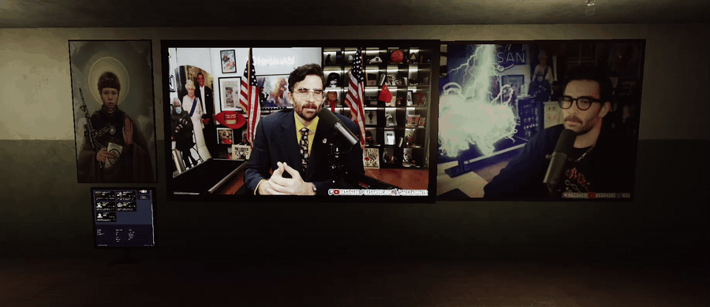
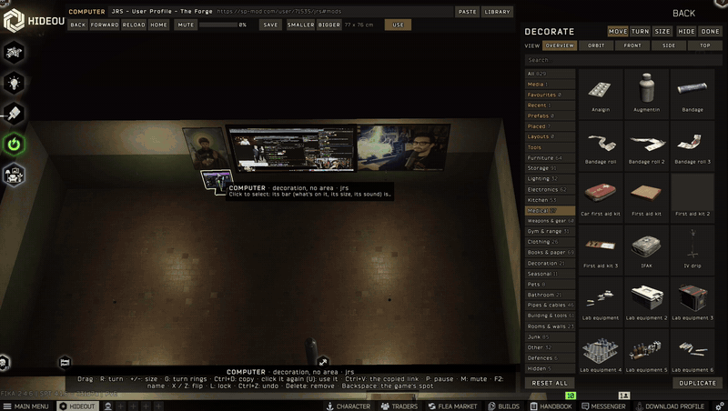
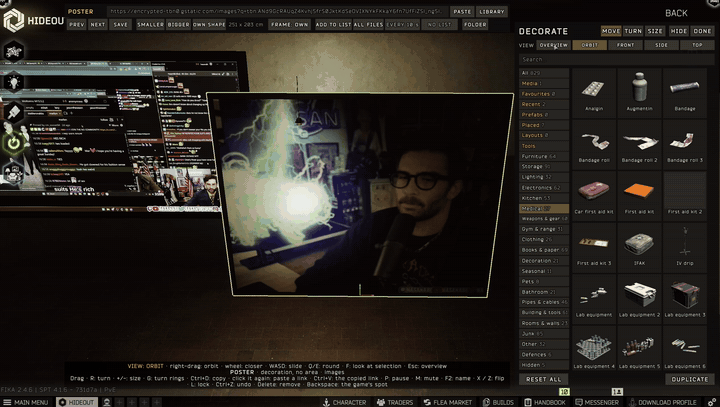
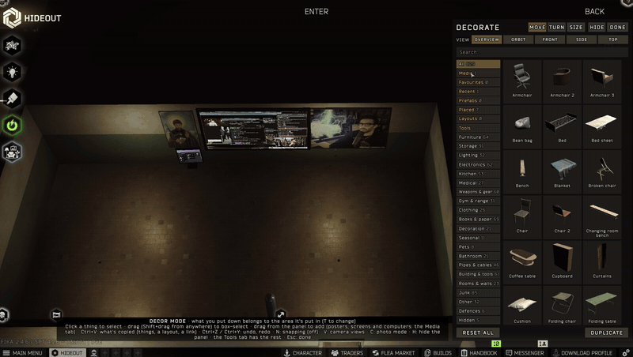

# Changelog

## 1.0.0

Needs SPT 4.1.x; client only (with Fika, the co-op part comes with it). Install over 0.2.0: what you've moved, hidden and put in carries over.

| | |
| --- | --- |
|  |  |
| **The computer** is a real browser: click it and use it. | **Posters** go flat on walls and size to their picture. |
|  |  |
| **New posters** come in blank: put them anywhere, then choose what's on them. | **The panel's new tabs**: favourites, recent, prefabs, placed, layouts and every tool as a button. |

### Posters, TV screens and computers

- **Posters from your own pictures.** The panel's new **Media** tab has a **Poster** to drag in. Once it's on the wall its bar shows along the top of the screen, its box ready: paste a link to a picture (Ctrl+V, Enter), or pick one of your own files from **LIBRARY** (the pictures in `BepInEx/plugins/HideoutInteriors/media`; each also has a cell in the Media tab to drag straight in). Pictures are .png or .jpg; ones from links are kept in `BepInEx/cache` so they come back without the internet.
- **TV screens that play videos** (.mp4 or .webm, from a link or the media folder), looping, with their sound from where they stand. A screen shows pictures too, and glows where a poster is lit by the room.
- **YouTube, Twitch and live streams.** A link to a YouTube video or live stream, a Twitch channel, a live stream's .m3u8, or any other web page plays on a screen with the video alone filling it. Type words in a screen's box to search YouTube, then click the video you want. Cookie boxes are said no to, and YouTube's skippable ads skipped. **WHOLE PAGE** shows the page round the video (to sign in, or pick another).
- **A Computer to browse the web on.** The mouse and keyboard work the page (click, scroll, type, Ctrl+C / Ctrl+V); its bar goes back, forward, reloads, home, takes an address or a search (Ctrl+L), and **SAVE** keeps the page as a bookmark. It comes back on the page you left it on. Pages are drawn by Edge's WebView2 (which Windows 10 and 11 have) in a small helper, `browser/HideoutBrowser.exe`, that runs beside the game and quits with it; logins are kept in `BepInEx/cache/HideoutInteriors/browser`.
- **Use them without decor mode.** On the hideout's overview, click a screen or computer: the camera goes in front of it and it's yours to use. Walking about the hideout, look at one and press **F** (a setting): the view goes square in front of it in the same way, you stand still and the mouse is free. A poster clicked or looked at brings its bar up with the box ready for a link. Esc, **DONE** or a click off it and you're back where you were.
- **Every poster, screen and computer has a bar** along the top when selected: the box for what's on it, **PASTE**, **LIBRARY**, **SMALLER** / **BIGGER**, and on a screen **PAUSE**, 10 seconds back and on, **MUTE**, a volume of its own, **PREV** / **NEXT** through your channels, and **SAVE** to keep what's on now as a channel.
- **Slideshows and playlists.** **ADD TO LIST** adds what's on now to its list, **ALL FILES** takes the whole media folder, **EVERY** sets how long a picture stays; videos play to their end.
- **Frames.** **FRAME** on the bar goes through its own, none, black, white, wood, dark wood, gold and silver.
- **Posters and screens hang flat on walls** when carried over one (R turns them on the wall), and stand up on floors and tables. **Carry a screen over one of the hideout's TVs** (or a monitor, or a laptop) and it fits the TV's front; or select the TV and press **Ctrl+V** with a video's link copied.
- **P** pauses the selected screens, **M** mutes them. Videos are quiet while you're in the game's other menus; **Video volume** in the settings is how loud they all are.

### Editing

- **Undo and redo.** **Ctrl+Z** steps back and **Ctrl+Y** (or Ctrl+Shift+Z) forward again, 60 steps: moves, turns, sizes, copies, things removed or hidden, what's on a poster, a light's colour, a layout loaded, even **RESET ALL**.
- **Anything can be made bigger or smaller, or stretched**, the hideout's own things as well as decorations. **+** / **-** size the selection (Shift: in small steps), and the gizmo's third kind, **SIZE**, stretches one thing along its own X, Y or Z (the block in the middle: all of it). A poster's or screen's handles set its width and height. **Backspace** puts one of the hideout's own back to the game's size as well as its spot.
- **Ctrl+D duplicates the selection** (the hideout's own things too, as decorations); the copies follow the mouse until you click.
- **Snapping.** **N** goes through off, a grid (25 cm; its size is on the Tools tab and in the settings), other things' edges, and both. Hold **Alt** for none this once. **B** drops the selection onto what's under it.
- **Lining up.** The **Tools** tab lines a selection up along X, Y or Z (low edges, middles or high edges), spaces it evenly, or puts it in a row.
- **Mirror.** **X** and **Z** mirror the selection across that axis, about its middle, as in a mirror: a left-handed thing comes out right-handed, for the other half of a symmetrical room. Again and it's as it was. (Posters and screens are only turned, so their pictures don't read backwards.)
- **Groups.** **Ctrl+G** locks a selection together under a name: a click on one picks them all (Alt+click: just the one). **Ctrl+Shift+G** takes it apart.
- **Locks.** **L** locks the selection: the mouse looks past it, and boxes and Ctrl+A leave it out. **Shift+L** unlocks everything.
- **Names.** **F2** gives the selection a name of your own.
- **Selecting.** Shift+drag from anywhere draws a selection box, on top of a thing too; **Ctrl+A** selects everything you can see on screen.

### Things that do something

- **Lights you control.** Anything with a lamp in it has a bar when selected: a switch (**O**), dimmer and brighter, and twelve colours. The **Lighting** tab has a **Light** and a **Spotlight** of the mod's own, made to be set.
- **Doors.** **I** (or a click on a selected door again) opens and shuts the hideout's own doors (the Security room's, the cultists' room's, the Emergency Wall's) and swings any decoration open on its upright edge. An open door stays open next visit.
- **Animations.** **I** has a copy play the animations of what it copies, and stops and starts the hideout's own animated things.
- **Things that wander.** **J** has a decoration wander about near where it stands.

### The panel

- **Every asset in the hideout's scene**: the parts things are made of, things with a skeleton, whatever stands under any root of the scene, and under a new **Rooms & walls** category the parts of the rooms themselves.
- **New tabs:** **Media** (posters, screens, the computer, your files), **Favourites** (right-click a thing), **Recent**, **Prefabs**, **Placed** (every decoration, to pick one that's hidden behind something; **LOOK** brings the camera to it), **Layouts** and **Tools** (every key as a button).
- **The panel fits the screen**, laid out for the size the game draws at; **Panel size** in the settings makes it smaller or bigger. **H** tucks it away.

### Camera

- **Camera views** to see what you've placed from the side: **ORBIT** round the selection, **FRONT**, **SIDE** and **TOP**, on the panel's **VIEW** row, with **V** or **1** to **5**. Right-drag goes round, the wheel comes closer, WASD slides, **F** looks at the selection again, Esc goes back to the overview.
- **Photo mode.** **C** clears the screen and lets the camera fly (WASD, Q / E, right-drag, the wheel zooms); **Space** takes a picture into `BepInEx/plugins/HideoutInteriors/photos`.
- **A walkthrough.** In photo mode **Shift+1** to **9** keep camera spots, **1** to **9** fly to them and **T** flies through them all.

### Saving and sharing

- **Layouts.** Save the whole arrangement under a name in the **Layouts** tab, and click one to load it (Ctrl+Z puts yours back). They're files in `BepInEx/config/HideoutInteriors/layouts`, and **COPY** / **PASTE** move one as text.
- **Prefabs.** **Ctrl+S** saves the selection (a finished desk, say) as a prefab; drag it in again from the **Prefabs** tab.
- **Copy and paste.** **Ctrl+C** copies the selection as text and **Ctrl+V** puts it in, in your hideout or anyone's.

### Co-op and raids

- **Your layout in hideout raids.** In a raid whose map is a copy of the hideout, your layout is put in without the raid's mod having to ask for it.
- **Fika.** The players of a raid send one another their layouts: each lands in the others' Layouts tab as "From *name*", and in a hideout raid everyone sees the host's. It's the new `HideoutInteriors.Fika.dll`, loaded only where Fika is; both can be switched off in the settings.

### Fixed

- **The panel ran off the right and bottom of the screen** where the game draws at another size than the window.
- **The bar of keys along the bottom, and the panel's RESET ALL and DUPLICATE, were hidden behind the game's menu bar.** They sit above it now.
- **The second "Tools" in the category list never opened.** It had the same name as the panel's tab of buttons; those things (bolts, brooms, buckets, wrenches) are under **Building & tools** now.
- **Photo mode left the game's menu bar along the bottom** in every picture. Every screen of the game's is put away now.
- **Rugs and carpets swung open like doors** on a second click (their names have "indoor" in them). Only things called a door, gate, hatch, turnstile or shutter do.
- **Escape while carrying left decor mode** with the things still in your hand; it puts them back now.
- **A selection box had to start on the floor**; Shift+drag starts one anywhere.
- **A blank "Poster" in the panel that did nothing when put in.** It was one of the game's poster slots (where the posters you own hang). The panel no longer offers those, or the statuette slots.
- **Right-clicking in an area's panel in decor mode could pick the area icon behind the panel.** Only an icon that's on top counts now.

## 0.2.0

Needs SPT 4.1.x; client only. Install over 0.1.0: what you've moved, hidden and put in carries over.

### Everything in the hideout

- **Every one of the hideout's things, not only the areas'.** The lamps on the walls and ceiling, the barrels and clutter that belong to no area, the seasonal decorations (Halloween's pumpkins, candles and bats, and the like), and things standing beside an area rather than in one of its levels can all be moved, turned, hidden, given to an area and copied from the panel. Things that belong to no area show as "the hideout (no area)" and stay where you put them.
- **The bunk bed, tractor tyre and aluminium ladder by the gym can be moved and hidden.** They're the Defective Wall's leftovers, kept in a group the mod didn't know, so they counted as one thing too big to pick up. The same went for the gear rack's and the cultists' room's PROPS. Each thing in those groups is now its own.
- Walls, floors, ceilings and the long cable runs are still the room: anything over 6 m across stays put.

### The decor panel

- **Pictures.** Most things showed a blank square: the game's materials only draw for its own camera, and after a dozen blanks in a row the panel stopped trying. Pictures are now drawn with plain copies of each thing's textures, and every thing gets one.
- **Plain names.** Things are called what they are (Metal bunk bed, Tall gun safe, Strip light, Pile of scrap) rather than by the game's file names (bed_metal_bunk, scontainer_gunsafe_tall, Lum_lamp_hideout, heap_scrap_3). Different models of the same thing are numbered (Armchair, Armchair 2...). The same names show when you point at things in the hideout.
- **New categories, in a list down the side** with how many things each holds: Furniture, Storage, Lighting, Electronics, Kitchen, Medical, Weapons & gear, Gym & range, Tools, Clothing, Books & paper, Decoration, Seasonal, Pets, Bathroom, Pipes & cables, Building, Junk. Other mods' own categories go after them. The list has room for more where the row of tabs didn't.
- The panel no longer offers colliders, decals, sound emitters and other parts of the scene that aren't things.

### For other mods

- **For modders:** `HideoutInteriorsApi.RaidCopySnapshot()` and `BuildRaidCopy(snapshot)` put your arrangement (things moved, given away or hidden, and your decorations) into a copy of the hideout that a mod loads as a raid map. In co-op everyone gets the host's.
- **For modders:** `HideoutInteriorsApi.AddDecor(key, name, kind, make)` puts a thing of your mod's in the decor panel, and `DecorOf(key)` finds the ones placed. A `kind` of your own becomes a tab of its own, and `AddDecor(key, name, kind, make, limit)` caps how many a hideout can have (the panel shows how many are in).
- Nothing runs in a raid copy once it's set up (it was looking for the hideout's overview every second, a stall you could feel).

## 0.1.0

First release. Needs SPT 4.1.x (made on 4.1.6); client only. Works with or without Hideout Extensions, and alongside Fika 2.4.

- **Decor mode** from a button on the hideout's overview.
- **Point at any of the hideout's things** to outline it and see what it is and which area it belongs to; click to select, Shift or Ctrl+click to add, drag on the floor to box-select.
- **Move** a selection by dragging it onto any surface, or exactly with the **X / Y / Z arrows** (Ctrl: 5 cm steps). **Turn** it with the **rings** (Ctrl: 15° steps) or R / Shift+R. G switches arrows and rings.
- **Give things to another area** by clicking its icon, or keep them with no area so they stay put when areas move.
- **Hide** the hideout's own things (Delete) and show them again from the Hidden tab; **Backspace** puts things back as the game has them; **RESET ALL** puts everything back.
- **Decorate with copies** of anything the hideout has, at every area level: a panel of every kind of thing, with pictures, by category, with a search box. Drag one into the hideout.
- The game's bar of areas is out of the way while decorating.
- Settings for the gizmo's size and thickness and the switch key.
