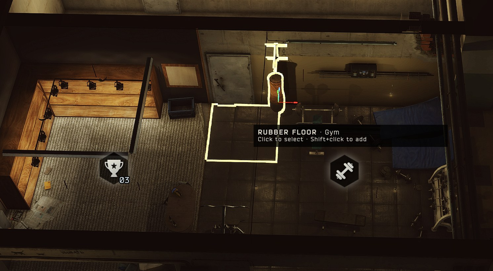
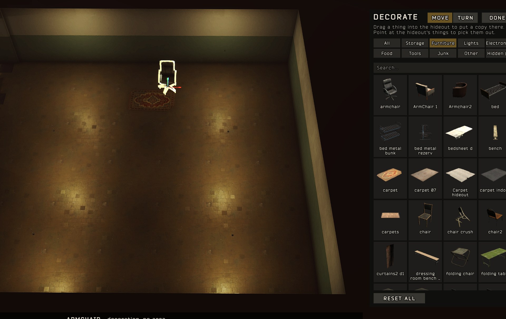

# Hideout Interiors

By JRS.

Hideout Interiors lets you arrange your hideout from the overview. Pick out any of the hideout's things (a box, a shelf, a lamp, the clutter on the floor, the seasonal decorations; the areas' and the ones that belong to no area), move and turn them exactly, give them to another area or to none, hide the ones you don't want, make them bigger, smaller or a different shape, and put in copies of anything the hideout has. Hang posters of your own pictures, put up TV screens that play videos, YouTube and live streams, and browse the web on a computer.

Undo and redo, snapping, lining things up, groups, locks, lights you set the colour and brightness of, doors that open, layouts and prefabs you can save and share, and a photo mode with a free camera are all in decor mode too.

It works on its own or alongside Hideout Extensions: areas moved there take the things given to them along.

## Installing

Needs SPT 4.1.x (made on 4.1.6). Works alongside Fika 2.4: decorating is your own hideout's, and in a raid the players' layouts are sent to one another (see **Co-op and raids**). Unzip into your SPT folder so that `BepInEx/plugins/HideoutInteriors` exists, then start the game. It's client-only: nothing goes in the server.

| Folder | What it is |
| --- | --- |
| `BepInEx/plugins/HideoutInteriors` | The mod and the decor button's picture. `HideoutInteriors.Fika.dll` is the co-op link: it's only loaded where Fika is installed. |
| `BepInEx/plugins/HideoutInteriors/photos` | Made the first time you take a picture in photo mode. |
| `BepInEx/config/HideoutInteriors/layouts` and `prefabs` | The layouts and prefabs you save: one file each, to keep or send to someone. |
| `BepInEx/plugins/HideoutInteriors/browser` | The helper that draws web pages for screens and computers. |
| `BepInEx/plugins/HideoutInteriors/media` | Made the first time the game starts: put your own pictures and videos here for posters and TV screens. |

## Decor mode

The **decor button** under the overview's own buttons (night vision, lights, customization, generator) turns decor mode on and off. The hideout's things are only outlined and picked out in decor mode, and the game's bar of areas along the bottom is out of the way until you leave it.

| Do this | What happens |
| --- | --- |
| **Point** at one of the hideout's things | It's outlined in white, and a note by the mouse says what it is and which area it belongs to |
| **Click** it | Selects it (outlined in amber) |
| **Shift+click** or **Ctrl+click** | Adds a thing to the selection, or takes it out |
| **Drag on the floor**, or **Shift+drag** from anywhere | Draws a box; everything in it you can see is selected (Shift adds to what's selected) |
| **Ctrl+A** | Selects everything you can see on screen |
| **Drag a selected thing** | Carries the whole selection. It sits on whatever is under the mouse; **R** / **Shift+R** turn it, **right-click** cancels |
| **Drag an arrow** (on the selection) | Moves the selection along just that line: red X, green Y (up and down), blue Z. **Ctrl**: 5 cm steps. The line at the bottom shows where it is |
| **G**, or **MOVE** / **TURN** / **SIZE** on the panel | Switches between the arrows, three quarter rings and the size handles. **Drag a ring** to turn the selection about X, Y or Z (**Ctrl**: 15° steps). **Drag a size handle** to stretch a thing along its own X, Y or Z, or the block in the middle to make all of it bigger or smaller (**Ctrl**: steps of a tenth) |
| **R** / **Shift+R** (not carrying) | Turns the selection a quarter / 15° where it stands |
| **Click an area's icon** (with things selected), or let go of carried things over one | They belong to that area from now on, where they stand: outlined with it, and moving when it moves |
| **T** | Whom what you put down belongs to: **the area it's put in**, **the area it belongs to now**, or **no area** (it stays put when areas move) |
| **Ctrl+Z** / **Ctrl+Y** (or **Ctrl+Shift+Z**) | Undo and redo, 60 steps back: moves, sizes, copies, things removed or hidden, lights, a layout loaded, **RESET ALL** |
| **N** | Snapping while you carry things: off, a grid, other things' edges, or both. Hold **Alt** while carrying for none this once. With the grid on, the arrows move in its steps |
| **B** | Drops the selection onto whatever is under it |
| **X** / **Z** | Mirrors the selection across X or Z, about its middle: a layout built on one side of a room makes the other, each thing mirrored as in a mirror (posters and screens are only turned, so they still read the right way). Again and it's as it was |
| **Ctrl+G** / **Ctrl+Shift+G** | Groups the selection under a name, or takes its groups apart. A click on one thing of a group picks all of it (**Alt+click**: just the one) |
| **L** / **Shift+L** | Locks the selection (the mouse looks past locked things, and boxes and Ctrl+A leave them out), or unlocks it; **Shift+L** unlocks everything. The **Placed** tab lists what's locked |
| **F2** | A name of your own for the selection; it shows wherever the thing's name does, and the **Placed** tab finds it |
| **O** | The light switch of the selected lamps (see **Lights**) |
| **I**, or a click on a selected door again | One of the hideout's doors, or any decoration, opens or shuts; one with animations plays or stops them (see **Things that do something**) |
| **J** | The selected decorations wander about near where they stand, or stay put again |
| **Ctrl+C** / **Ctrl+V** | Copies the selection as text and puts it in again, here or in someone else's game. Ctrl+V also loads a copied layout, and (as before) puts a copied link on posters and screens |
| **Ctrl+S** | Saves the selection as a prefab (see **Layouts and prefabs**) |
| **C** | Photo mode (see below) |
| **Ctrl+D**, or **DUPLICATE** on the panel | Copies the selection (the hideout's own things too, as decorations); the copies follow the mouse until you click |
| **+** / **-** | Makes the selection bigger or smaller, the hideout's own things too (**Shift**: small steps) |
| **V**, **1** to **5**, or the panel's **VIEW** row | Camera views: see the selection from round about, the front, the side or straight down (see below) |
| **H**, or **HIDE** on the panel | Tucks the panel away; the tab on the right brings it back |
| **P** / **M** | Pauses / mutes the selected screens' videos (their bars do too) |
| **Click a selected poster, screen or computer again** (or **U**, **Enter**) | A poster's box takes a link; a screen is watched and a computer used, the camera in front of it (see below) |
| **Delete** | Takes decorations away; hides the hideout's own things (the **Hidden** tab lists them, click one to show it again) |
| **Backspace** | Sends the hideout's own things back where, to whom and at the size the game has them |
| **RESET ALL** (bottom of the panel, click twice) | Puts every thing back where, and to whom, the game has it, shows the hidden ones again and takes every decoration away (Ctrl+Z brings it back) |
| **Esc** or **DONE** | Puts back what's carried; in a camera view, back to the overview; else leaves decor mode |

The panel on the right holds every thing the hideout has, at every area level (built or not), once each, by kind: storage, furniture, lights, electronics, food, tools, junk and the rest. Click the **search** box under the kinds and type to find things by name (in the kind you're on; **All** searches everything). While you type, decor mode's keys and the camera's WASD, Q and E wait; Enter, Escape or a click elsewhere is done. **Drag one into the hideout** to put a copy there; let go over the panel to put it back. Copies are only the thing's look (and its lights): no game scripts, nothing to loot, a plain box round it to stand against. Each gets a picture the first time it scrolls into view; one the game won't draw outside its own camera shows its name only.

The panel has everything the hideout's scene holds, not only the areas' things: the parts things are made of, things with a skeleton, and under **Rooms & walls** the parts of the rooms themselves (walls, floors, pipe runs). Those are for copying; the rooms' own stay where they are.

The amber tabs at the top of the list are the panel's own:

| Tab | What's in it |
| --- | --- |
| **Favourites** | The things you've marked: **right-click** a thing in any tab to make it a favourite (its name is amber from then on), again to take it out |
| **Recent** | The last 30 things you took from the panel, the last first |
| **Prefabs** | Selections you've saved, to drag in again as they were (see **Layouts and prefabs**) |
| **Placed** | Every decoration in the hideout, by name, with its area, group and lock. Click one to select it (Shift adds), **LOOK** to bring the camera to it: the way to pick one that's behind something. Groups and the hideout's own locked things are listed under them |
| **Layouts** | Whole arrangements saved under a name (see **Layouts and prefabs**) |
| **Tools** | Everything above as buttons: undo and redo, the snapping kinds and the grid's size, lining up, spacing, rows, flipping, groups, locks, lights, saving and copying, photo mode |

The search box works in these too: in **Placed** it finds a decoration by its name, your name for it, or its group.

### Lining up

With a few things selected, the **Tools** tab lines them up:

| Row | What it does |
| --- | --- |
| **Along X / Y / Z**: LOW, MIDDLE, HIGH | Brings their low edges, middles or high edges into one line along that axis (along Y: bottoms, middles or tops) |
| **Space evenly**: X, Y, Z | The same gap between each along that axis; the first and last stay where they are (three things or more) |
| **In a row**: ALONG X, ALONG Z | Side by side from where the first stands, in one line: shelves, lockers, posters |
| **Flip**: ACROSS X, ACROSS Z | The same as **X** and **Z** |

### Lights

Select anything with a lamp in it (the hideout's own lamps, copies of them, or the **Light** and **Spotlight** in the **Lighting** tab, which are the mod's own and made to be set) and its bar is along the top of the screen: **ON / OFF**, **DIMMER** and **BRIGHTER** (the number goes back to its own brightness), and a row of colours (**OWN** is the lamp's own). **O** is the switch. With several lamps selected the bar sets them all. The Spotlight shines along its blue arrow: turn it with the rings. What's set is kept with the thing; **Backspace** puts one of the hideout's own back as the game has it.

### Things that do something

- **Doors.** Select a decoration and press **I**: it swings open on its narrower upright edge, and shut again. A decoration called a door, gate, hatch or shutter also opens with a click on it once it's selected. It works on any decoration (a cupboard, a fridge, a crate's lid stood on its side), and on the hideout's own doors (the Security room's, the cultists' room's, the Emergency Wall's), which stay open next visit. Other things of the hideout's own don't swing: copy one first (**Ctrl+D**).
- **Animations.** A copy is only a thing's look. If what it copies has animations, **I** has the copy play them, and stops them again; a copy of a thing with a skeleton plays them from the start. One of the hideout's own things with animations or particles is stopped and started by **I**.
- **Wandering.** **J** has the selected decorations wander within a few steps of where they stand, on the same floor, turning to face where they go and stopping a while between: for a pet, or anything else you like. They hold still while selected. Put one somewhere else and it wanders from there.

### Layouts and prefabs

A **layout** is everything you've changed: the things moved, sized, given away and hidden, and every decoration. In the **Layouts** tab, **SAVE THIS LAYOUT AS...** keeps it under a name; click a saved one to load it (Ctrl+Z puts yours back), **SAVE** on its row to save over it, **DELETE** twice to delete it. **COPY** puts the layout on the clipboard as text and **PASTE** loads one from it, so a layout can be sent in a message. The files are in `BepInEx/config/HideoutInteriors/layouts`, shared by every profile: copy one to someone else's and it's in their tab.

A **prefab** is a selection kept as its things stand to one another: a finished desk, a row of lockers. **Ctrl+S** (or the **Prefabs** tab's **SAVE**) asks for a name; **drag it in** from the tab to put it in again, as often as you like. The hideout's own things in it come back as copies. A group in a prefab is a group of its own each time. The files are in `BepInEx/config/HideoutInteriors/prefabs`.

Things that came from another mod's panel entries, or from an area your hideout hasn't got, are left out when a layout or prefab from someone else is put in, and wait for it in a layout.

### Photo mode

**C** (or the Tools tab's **PHOTO MODE**) clears the screen of every button, panel, outline and gizmo and lets the camera fly:

| Do this | What happens |
| --- | --- |
| **W A S D**, **Q** / **E** | Fly forwards, sideways, down and up (**Shift**: fast, **Ctrl**: slow) |
| **Right-drag** | Look about |
| **Wheel** | Zoom (a longer or wider lens) |
| **Space** | Takes a picture, into `BepInEx/plugins/HideoutInteriors/photos` |
| **Shift+1** to **9** | Keeps where the camera is as a camera spot |
| **1** to **9** | Flies to that spot |
| **Ctrl+1** to **9** | Forgets it |
| **T** | A walkthrough: flies through the spots in order (T again stops it) |
| **Esc** | Back to decor mode |

The camera spots are kept per profile. The picture key, how big pictures are (up to 4 times the screen) and how long the walkthrough takes between spots are in the settings.

### Camera views

From the overview's height it's hard to see whether something's turned right. The **VIEW** row on the panel (or **V**, one after another, or **1** to **5**) moves the camera down to it:

| View | What it shows |
| --- | --- |
| **OVERVIEW** (1) | The game's own camera, where you left it |
| **ORBIT** (2) | Round the selection, from a little above |
| **FRONT** (3) | Level, looking along the blue Z arrow; again for the back |
| **SIDE** (4) | Level, looking along the red X arrow; again for the other side |
| **TOP** (5) | Straight down on the selection |

In a view: **right- or middle-drag** goes round, the **wheel** comes closer, **WASD** slides, **Q** / **E** turn, **F** looks at the selection again, **Esc** goes back to the overview. Everything else works as on the overview: select, drag, arrows and rings. With nothing selected a view looks at the middle of the screen.

### Posters and TV screens

The **Media** tab holds a **Poster**, a **TV screen** and a **Computer**. Drag one in and put it where you want it; what's on it is chosen on it afterwards. (Each picture and video in `BepInEx/plugins/HideoutInteriors/media` has a cell too, to drag in already showing; **Open the media folder** opens it.)

**Using one without decor mode.** Once it's in, you don't need decor mode to watch a screen, use a computer or change a poster's picture. On the hideout's overview, click it. Walking about the hideout, look at it and press **F** (the "Use key in first person" setting); you stand still and the mouse is free while you use it. Esc, **DONE** or a click off it and you're back.

**Select one and its bar is along the top of the screen:**

| On the bar | What it does |
| --- | --- |
| **The box** | What's on it. Click it and paste a link (**Ctrl+V**, then **Enter**), or type a file's name from the media folder. On a screen, words search YouTube. A new poster or screen's box is ready as soon as you put it down |
| **PASTE** | Puts the copied link on it |
| **LIBRARY** | Your media folder's files and your saved channels: click one to put it on (**REMOVE** takes a channel out) |
| **PREV** / **NEXT** | The one before or after in the library |
| **SAVE** | Keeps what's on now as a channel (on a computer, a bookmark) |
| **PAUSE**, **-10 s**, **+10 s** | A screen's video |
| **MUTE** and the volume track | This screen's own sound: click or drag along the track |
| **SMALLER** / **BIGGER** | Its size (or **+** / **-**, or the gizmo's **SIZE** handles for its width and height alone; **OWN SHAPE** goes back to the picture's or video's shape) |
| **FRAME** | Its frame: its own, none, black, white, wood, dark wood, gold or silver |
| **ADD TO LIST**, **ALL FILES**, **EVERY 10 s**, **NO LIST** | A list it goes through in turn: a slideshow on a poster, a playlist on a screen. Put something on and **ADD TO LIST**, then the next thing and again; **ALL FILES** makes the list of everything in the media folder. Pictures stay as long as **EVERY** says (5 seconds to 10 minutes), videos play to their end. **PREV** / **NEXT** go through the list while there is one; the last button clears it |
| **WHOLE PAGE** / **VIDEO ONLY** | A screen showing a web page: the page round the video, to sign in or pick another |
| **WATCH** / **USE** | The camera goes in front of it (the same as clicking it again, **U** or Enter) |

**Watching a screen or using a computer**, the camera is in front of it and the decor panel out of the way; the bar stays, so the link, the channel, the volume and the size can all be changed from there. On a web page the mouse and keyboard work the page (click, scroll, type, Ctrl+C / Ctrl+V; **Ctrl+L** is the bar's box). On a video file **Space** pauses, **left** / **right** skip 10 seconds, **up** / **down** are louder and quieter, **M** mutes, **,** and **.** change channel. **Esc**, **DONE** or a click off the screen comes back.

- Posters show pictures (.png or .jpg). Screens show pictures too, and play videos (.mp4 or .webm) on a loop with their sound from where they stand.
- **YouTube, Twitch and live streams:** give a screen a link to a YouTube video or live stream, a Twitch channel, a stream's .m3u8 or any web page, and it plays with the video alone filling the screen. Cookie boxes are said no to and YouTube's skippable ads skipped. YouTube's search results and channel pages show whole, to pick a video from.
- **The Computer** is a web browser on a stand: its bar goes back, forward, reloads and home, and its box takes an address or a search. It stays on the page you left it on.
- Web pages are drawn by Edge's WebView2, which Windows 10 and 11 have, in a small helper (`browser/HideoutBrowser.exe`) that starts the first time a page is shown and quits with the game. Their sound isn't from where they stand, but gets quieter as the camera goes farther away. Logins are kept in `BepInEx/cache/HideoutInteriors/browser`.
- Carried over a wall they hang flat on it (**R** turns them on the wall); over a floor or table they stand up.
- **On the hideout's TVs:** carry a screen over a TV, monitor or laptop and it fits its front (hold **Alt** not to). Or select the TV, copy a video's link and press **Ctrl+V**.
- **Ctrl+V** in the hideout puts the copied link on the selected posters and screens without opening anything.
- Pictures from links are kept in `BepInEx/cache/HideoutInteriors`, so they come back without the internet. Videos from links play from the link each time.
- Saved channels are in `BepInEx/config/jrs.hideoutinteriors.channels.json`, shared by every profile.

What you change is kept per profile in `BepInEx/config`:

- `jrs.hideoutinteriors.items.<profile id>.json`: the hideout's things you moved, sized, gave away or hid. Delete it to put them all back.
- `jrs.hideoutinteriors.decor.<profile id>.json`: your decorations. Delete it to take them all away.
- `jrs.hideoutinteriors.cameras.<profile id>.json`: photo mode's camera spots.

Your favourites and recent things are in `jrs.hideoutinteriors.panel.json`, shared by every profile.

## Co-op and raids

- **A raid on a copy of the hideout.** Where another mod loads your hideout as a raid's map, your arrangement is there too: the mod looks for a hideout a few seconds into every raid and puts the layout in (**Show my layout in hideout raids** in the settings). A mod that asks for it itself still has its way, and should if it moves the areas.
- **With Fika**, the players of a raid send one another their layouts as the raid starts. Each lands in the others' **Layouts** tab as "From *name*", to load in your own hideout and keep or change; and in a raid on a copy of the hideout everyone sees the host's. **Share layouts with co-op teammates** in the settings switches yours off: then it's still sent from a host (a hideout raid needs it) but nobody keeps it. Every player needs the mod; ones without it are left alone.
- Decorating itself is still each player's own: nobody sees your hideout change as you work on it.

## For other mods

A mod that loads your hideout as a raid map can bring your arrangement with it: the things you've moved, given away or hidden, as you left them, with your decorations. In co-op everyone gets the host's.

For modders: `HideoutInteriorsApi.RaidCopySnapshot()` gives the playing profile's arrangement as text, and `HideoutInteriorsApi.BuildRaidCopy(snapshot)` puts it into the hideout scene loaded as a raid's map. Call it after the areas stand where they'll stay (after Hideout Extensions' `BuildRaidCopy`). The mod puts the layout in by itself a few seconds into such a raid; a call of yours, before or after, replaces what that put in. The player's files are left alone. A saved layout file is the same text as a snapshot.

Other mods can add things of their own to the decor panel: `HideoutInteriorsApi.AddDecor(key, name, kind, make)`, called at startup, puts one under `kind`, where `make` builds the thing the copies are taken from. `kind` is one of the panel's tabs, or a name of the mod's own, which becomes a tab after Other. `AddDecor(key, name, kind, make, limit)` also caps how many a hideout can have: the panel shows "2 of 6" under it and won't put more in. Placed ones are kept under the key, and come back wherever that mod has added it again. `HideoutInteriorsApi.DecorOf(key)` gives the ones placed right now.

## Settings

Press **F12** in game and open **JRS-HideoutInteriors**, or edit `BepInEx/config/jrs.hideoutinteriors.cfg`.

| Section | Setting | Default | What it does |
| --- | --- | --- | --- |
| Decorating | Enabled | On | The decor button on the overview. |
| Decorating | Gizmo size | 1 | How big the move arrows, turn rings and size handles are (0.3 to 3). |
| Decorating | Gizmo thickness | 1 | How thick they are (0.3 to 3). |
| Decorating | Switch move / turn | G | The key that goes from arrows to rings to size handles. |
| Decorating | Video volume | 0.6 | How loud the TV screens' videos are at most (0 to 1); each screen's own volume, on its bar, is a part of this. |
| Decorating | Panel size | 1 | How big the decor panel and the line of keys are (0.6 to 1.5). |
| Decorating | Snapping | Off | What carried things snap to: Off, Grid, Edges or Both (**N** in decor mode). |
| Decorating | Grid size | 0.25 | The snapping grid's step in metres (0.05 to 2). |
| Photo mode | Take a picture | Space | The key that takes a picture in photo mode. |
| Photo mode | Picture size | 1 | How many times the screen's size a picture is (1 to 4). |
| Photo mode | Tour seconds per spot | 4 | How long the walkthrough flies from one camera spot to the next (1 to 20). |
| Sharing | Show my layout in hideout raids | On | Puts your layout into a raid whose map is a copy of the hideout. |
| Sharing | Share layouts with co-op teammates | On | With Fika: sends your layout to the other players of a raid, and keeps theirs in your Layouts tab. |
| General | Areas things never join | `EmergencyWall` | Areas that what you put down never joins on its own (the emergency wall's zone holds a whole room). |

## Uninstalling

Delete `BepInEx/plugins/HideoutInteriors`. The hideout is as the game has it again; your files in `BepInEx/config` stay, so it all comes back if you put the mod back.

## Licence

MIT, see `LICENSE.txt`.
