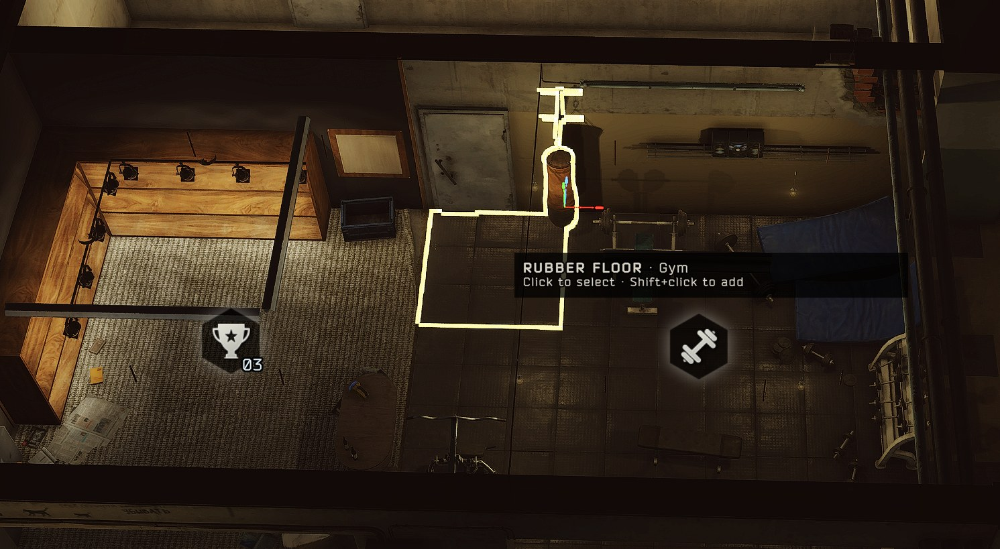
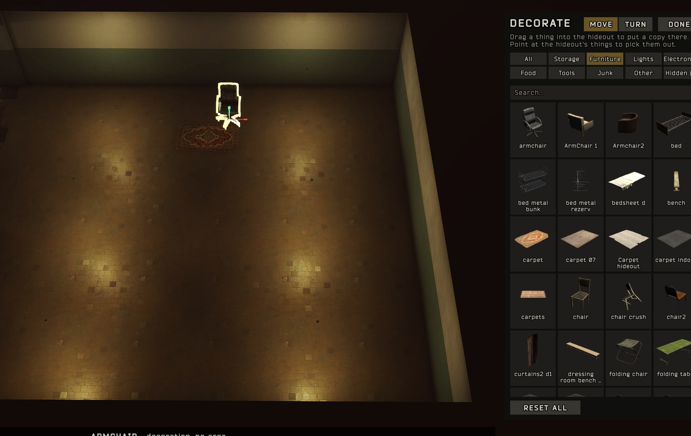

# Hideout Interiors

By JRS.

Hideout Interiors lets you arrange your hideout from the overview. Pick out any of the hideout's things (a box, a shelf, a lamp, the clutter on the floor, the seasonal decorations; the areas' and the ones that belong to no area), move and turn them exactly, give them to another area or to none, hide the ones you don't want, and put in copies of anything the hideout has.

It works on its own or alongside Hideout Extensions: areas moved there take the things given to them along.

## Installing

Needs SPT 4.1.x (made on 4.1.6). Works alongside Fika 2.4: decorating is your own hideout's and isn't shared in co-op. Unzip into your SPT folder so that `BepInEx/plugins/HideoutInteriors` exists, then start the game. It's client-only: nothing goes in the server.

| Folder | What it is |
| --- | --- |
| `BepInEx/plugins/HideoutInteriors` | The mod and the decor button's picture. |

## Decor mode

The **decor button** under the overview's own buttons (night vision, lights, customization, generator) turns decor mode on and off. The hideout's things are only outlined and picked out in decor mode, and the game's bar of areas along the bottom is out of the way until you leave it.

| Do this | What happens |
| --- | --- |
| **Point** at one of the hideout's things | It's outlined in white, and a note by the mouse says what it is and which area it belongs to |
| **Click** it | Selects it (outlined in amber) |
| **Shift+click** or **Ctrl+click** | Adds a thing to the selection, or takes it out |
| **Drag on the floor** | Draws a box; everything in it you can see is selected |
| **Drag a selected thing** | Carries the whole selection. It sits on whatever is under the mouse; **R** / **Shift+R** turn it, **right-click** cancels |
| **Drag an arrow** (on the selection) | Moves the selection along just that line: red X, green Y (up and down), blue Z. **Ctrl**: 5 cm steps. The line at the bottom shows where it is |
| **G**, or **MOVE** / **TURN** on the panel | Switches between the arrows and three quarter rings. **Drag a ring** to turn the selection about X, Y or Z (**Ctrl**: 15° steps) |
| **R** / **Shift+R** (not carrying) | Turns the selection a quarter / 15° where it stands |
| **Click an area's icon** (with things selected), or let go of carried things over one | They belong to that area from now on, where they stand: outlined with it, and moving when it moves |
| **T** | Whom what you put down belongs to: **the area it's put in**, **the area it belongs to now**, or **no area** (it stays put when areas move) |
| **Delete** | Takes decorations away; hides the hideout's own things (the **Hidden** tab lists them, click one to show it again) |
| **Backspace** | Sends the hideout's own things back where, and to whom, the game has them |
| **RESET ALL** (bottom of the panel, click twice) | Puts every thing back where, and to whom, the game has it, shows the hidden ones again and takes every decoration away |
| **Esc** or **DONE** | Leaves decor mode |

The panel on the right holds every thing the hideout has, at every area level (built or not), once each, by kind: storage, furniture, lights, electronics, food, tools, junk and the rest. Click the **search** box under the kinds and type to find things by name (in the kind you're on; **All** searches everything). While you type, decor mode's keys and the camera's WASD, Q and E wait; Enter, Escape or a click elsewhere is done. **Drag one into the hideout** to put a copy there; let go over the panel to put it back. Copies are only the thing's look (and its lights): no game scripts, nothing to loot, a plain box round it to stand against. Each gets a picture the first time it scrolls into view; one the game won't draw outside its own camera shows its name only.

What you change is kept per profile in `BepInEx/config`:

- `jrs.hideoutinteriors.items.<profile id>.json`: the hideout's things you moved, gave away or hid. Delete it to put them all back.
- `jrs.hideoutinteriors.decor.<profile id>.json`: your decorations. Delete it to take them all away.

## In the siege

Tushonka: Hideout Under Siege loads your hideout as a raid map, and the things you've moved, given away or hidden are as you left them there, with your decorations. In co-op everyone gets the host's.

For modders: `HideoutInteriorsApi.RaidCopySnapshot()` gives the playing profile's arrangement as text, and `HideoutInteriorsApi.BuildRaidCopy(snapshot)` puts it into the hideout scene loaded as a raid's map. Call it once per raid, after the areas stand where they'll stay (after Hideout Extensions' `BuildRaidCopy`). The player's files are left alone.

Other mods can add things of their own to the decor panel: `HideoutInteriorsApi.AddDecor(key, name, kind, make)`, called at startup, puts one under `kind`, where `make` builds the thing the copies are taken from. `kind` is one of the panel's tabs, or a name of the mod's own, which becomes a tab after Other. `AddDecor(key, name, kind, make, limit)` also caps how many a hideout can have: the panel shows "2 of 6" under it and won't put more in. Placed ones are kept under the key, and come back wherever that mod has added it again. `HideoutInteriorsApi.DecorOf(key)` gives the ones placed right now. Tushonka: Hideout Under Siege adds a Defences tab this way: sandbags, a steel barricade, barbed wire and its mounted gun.

## Settings

Press **F12** in game and open **JRS-HideoutInteriors**, or edit `BepInEx/config/jrs.hideoutinteriors.cfg`.

| Section | Setting | Default | What it does |
| --- | --- | --- | --- |
| Decorating | Enabled | On | The decor button on the overview. |
| Decorating | Gizmo size | 1 | How big the move arrows and turn rings are (0.3 to 3). |
| Decorating | Gizmo thickness | 1 | How thick the move arrows and turn rings are (0.3 to 3). |
| Decorating | Switch move / turn | G | The key that switches between arrows and rings. |
| General | Areas things never join | `EmergencyWall` | Areas that what you put down never joins on its own (the emergency wall's zone holds a whole room). |

## Uninstalling

Delete `BepInEx/plugins/HideoutInteriors`. The hideout is as the game has it again; your files in `BepInEx/config` stay, so it all comes back if you put the mod back.

## Licence

MIT, see `LICENSE.txt`.
